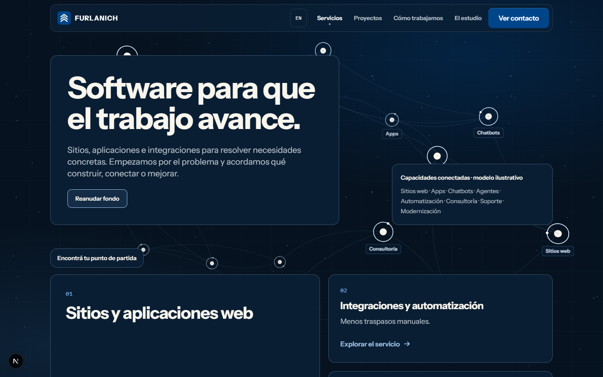
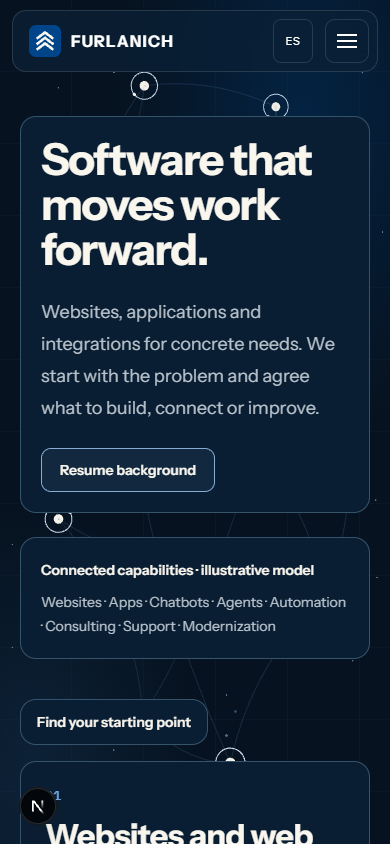
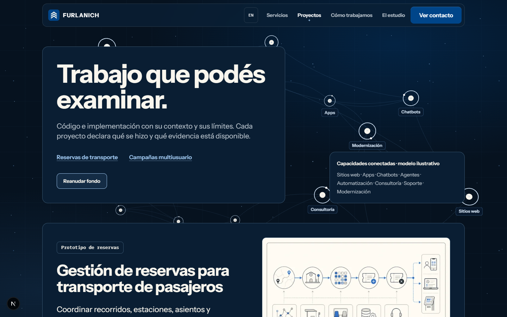
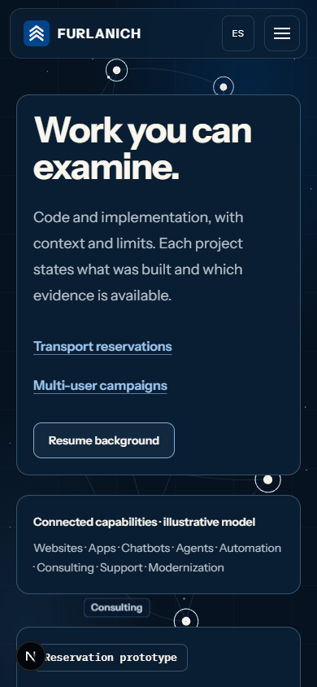

# Task 8 — corrections following independent review, 2026-10-12

Scope: owner-authorized corrections to [PR #132](https://github.com/Furlanich/Portfolio/pull/132), following [independent review #133](https://github.com/Furlanich/Portfolio/pull/133) of pinned head `07d1c9279c0ca07f4b0913b6221deae68bc68d2f`. Authority: [PLAN-SPF-V1](../../plans/active/services-projects-footer-v1.md), [DESIGN-SPF-V1](../../design/services-projects-footer-v1.md), original [Task 8 receipt](task-8.md). This is an implementation/self-verification receipt; it does not supersede the independent review or grant acceptance.

Agent usage: primary GPT-6 (Codex; exact provider model identifier/settings unavailable); subagents 0/0 (none). SINGLE_AGENT / IMPLEMENTATION. The initially independent reviewer became the correction implementer at the owner's request. Fresh separate-session re-review is OPEN.

Branch/worktree: `codex/spf-task-8-review-corrections` in the managed `spf-task-8-independent-review` checkout; corrections are pushed to PR #132's `codex/spf-8-connected-posters` branch without force. Current merged main `c04f8ec1` (accepted W5 #131 and CI limit #130) is incorporated. Documentation conflicts retained both W5 clearance and Task 8 history. No main push or PR merge.

| Finding | Correction | Status |
| --- | --- | --- |
| SPF-T8-01 — persistent frozen network | Ground marks live only after a successful draw; the poster fades out over 160ms and is restored immediately on disposal. Pause holds only the drawn live field (viewport/graph resize is deferred until Resume, retaining its painted backing store and scaling label anchors); preferences/context/import failure retain the complete static fallback. | IMPLEMENTED; independent re-review OPEN |
| SPF-T8-02 — different first-frame projection/crop | Shared CSS capture sizes/alignment drive geometry and a fixed-camera view offset. Tablet initially uses the wide poster's depth/travel. Projection and progress ease to the normal responsive layout over the existing three-second settle; labels follow the same projection. No second graph, resources or draw calls. | IMPLEMENTED; independent re-review OPEN |
| SPF-T8-03 — bead presented as approved | Owning design amendment and dependent summaries distinguish the approved flat-dot/ring direction from the implementer's proposed bead. Runtime retains the candidate for owner inspection. | DOCUMENTATION CORRECTED; bead approval OPEN |

Skills: systematic-debugging, test-driven-development, frontend-implementation, playwright-qa, visual-qa, superpowers:executing-plans (bounded correction inline), resolving-merge-conflicts, project-knowledge-maintenance, verification-before-completion, pr-readiness. Any delegation workflow ran inline under GOV-AGENT-USAGE; no helper or implementer-owned reviewer. Taste preflight is constrained by the approved Azure/Bone system, flat dot/ring direction and existing layout; no new composition or motion tuning. React quality review: static server Ground remains lightweight, engine projection remains in the gated dynamic closure, transient DOM state is restored through cleanup, no new React state/listeners or meaningful content changes.

## Regression evidence

Before production edits, `node --test --test-name-pattern="first live frame matches poster|projection starts on the poster" scripts/connected-studio-engine.test.mjs scripts/connected-studio-controller.test.mjs` failed all five intended cases: four real projected-geometry mismatches and the missing projection-settle signal. The two browser cases `--project=immersive-chromium --grep 'removes the poster after a live draw'` failed on poster opacity 1 rather than 0 on both routes. After the correction the complete engine/controller suites passed 75/75 and the two original browser cases passed 2/2. The browser regression was then expanded to both routes at four viewports (ES wide/tablet, EN compact).

The geometry oracle uses actual instance matrices, distant-sprite positions/sizes, path/skeleton vertices and the renderer camera at 1440×900, 768×1024, 390×844 and 320×800 against the source poster's CSS cover transform (0.002px tolerance). It also verifies label anchors, restored responsive geometry, camera position and unchanged draw calls. Controller coverage verifies settle, Pause holding zero draws and Resume without replay. A further size guard found that screen-sized distant sprites also needed the poster cover scale (three expected RED failures; 320×800 passed because cover scale is 1); their size now eases with the field. An attempted exact label-rim test assumed an on-axis circle despite the existing camera-facing tilted planes; corrected the test oracle to use the captured label anchor and a bounded below-node check without altering label sizing.

Follow-up RED/GREEN: the poster handoff exposed an existing paused-resize path that clears the WebGL backing store while scheduling zero draws. A real screenshot after 1440→768 resize showed only the CSS chart. The regression `a paused scene retains its painted frame through remeasurement and resize` failed on the backing-store reset before the host correction. The host now defers viewport/graph fitting while paused, retains the composited paint, scales label anchors with it, and fits the latest viewport/quality on Resume without replaying the poster settle. Its first GREEN attempt passed the paint/resize/zero-draw checks but used a nonexistent `quality` diagnostic for the final compact assertion; changed it to the existing `tier` field. The final focused run passed all nine cases. The test checks equal paint on same-size remeasurement, unchanged backing store/draw count and zero scheduled callbacks through resize, then a compact eight-node scene on Resume.

## Rendered observations

Windows Chromium/SwiftShader, root path, controlled live opt-in: inspected paused top frames for Services/Projects at 1440×900 ES, 768×1024 ES, 390×844 EN and 320×800 EN. One network, faint skeleton at zero growth, no frozen bright connections; reading plates remain legible and the checked frames show no content clipping or duplicate nodes. These are agent judgments, not owner approval. Motion was exercised by assertions, not a visual recording. The development indicator is visible in these captures.

| Route | 1440×900 ES | 390×844 EN |
| --- | --- | --- |
| Services |  |  |
| Projects |  |  |

Poster reproducibility: `CAPTURE_ORIGIN=http://127.0.0.1:3320 node scripts/capture-connected-studio-posters.mjs` on the harness-owned server, exit 0. All four re-captures were byte-identical to the committed originals (wide 87164 B, compact 50434 B). Capture explicitly bypasses the CSS fade while its clock is held. Originals were restored from a temporary backup and no poster/baseline file enters the correction diff.

## Fresh final validation

`npm run validate` → **PASS**, exit 0: docs:check (107 document IDs, 38 Skills; its 335-file scan includes ignored browser error-context Markdown), Node tests **497/497**, lint **0 errors / 282 existing warnings**, typecheck and clean root build. `npm run verify:static-export` → **PASS**, exit 0, 14 routes at `/`. `NEXT_PUBLIC_BASE_PATH=/Portfolio npm run build` and the same-environment `npm run verify:static-export` → **PASS**, exit 0, 14 routes at `/Portfolio`. Node reported the existing MODULE_TYPELESS_PACKAGE_JSON notice; browser runs reported NO_COLOR/FORCE_COLOR notices and expected reduced-motion diagnostics, separately from failures. Only this documentation receipt changed after these application gates; final docs:check and diff check were rerun before commit.

- Focused corrections: `PLAYWRIGHT_PORT=3320 npm run test:e2e -- tests/e2e/connected-studio-runtime.spec.ts --project=immersive-chromium --workers=1 --grep 'removes the poster after a live draw|paused scene retains'` → **9/9 passed**, exit 0.
- Complete connected runtime on a fresh harness-owned server: `PLAYWRIGHT_PORT=3321 npm run test:e2e -- tests/e2e/connected-studio-runtime.spec.ts --project=immersive-chromium --workers=1` → **59 passed / 1 failed**, exit 1 (6.1 minutes). All nine new regressions, preference/context/error fallback, Pause/Resume, resize and start-pose cases passed. The unchanged Task 7 first-scroll-notch case failed its peak-activity `> 0.02` assertion (observed 0.00774666). Unchanged isolated `--grep 'first scroll notch' --repeat-each=3` → **3 failed**, exit 1. The original Task 8 receipt Finding 8 already records the same failure and an unmodified W5 control; no new control is claimed here. Cause is unresolved; no threshold or expectation was weakened. Runtime acceptance is **FAIL/OPEN**, not a zero-failure suite.
- Visual regression: `PLAYWRIGHT_PORT=3321 npm run test:e2e -- --project=visual-chromium --workers=1` → **75/75 passed**, exit 0 (2.0 minutes). Existing Windows baselines only; no baseline update or approval.
- Broad matrix attempt: `PLAYWRIGHT_PORT=3320 npm run test:e2e -- --workers=2` scheduled 2677 cases. Stopped the harness's own process tree after repeated 60-second SwiftShader context-teardown stalls and severe concurrent live-renderer contention; **2263 passed / 16 failed / 130 skipped** had completed (2409 total). This is an **interrupted/degraded attempt**, not a complete or passing matrix. The 16 failures comprise six desktop navigation cases and ten immersive-runtime cases; their original logs are retained locally. All 24 accessibility cases and all 89 wide cases completed successfully. Home immersive and visual completion were not reached in this attempt.
- Unchanged rerun of the six failed navigation scenarios, with Chromium/Firefox controls: `PLAYWRIGHT_PORT=3320 npm run test:e2e -- tests/e2e/connected-studio-navigation.spec.ts tests/e2e/connected-studio-footer.spec.ts --project=chromium-desktop --project=firefox-desktop --workers=1 --grep 'middle click the instant|no host page overflows sideways.*1440px|en projects modified current-page|Spanish switch drops.*mpc-administracion'` → **12/12 passed**, exit 0 (2.3 minutes). The single-worker runtime run above followed the interrupted live cases; it leaves the inherited notch failure open. These reruns do not erase the initial failures or complete the matrix.

Ignored local logs: `.playwright/correction-full-e2e.log`, `correction-partial-counts.json`, `correction-failure-reruns.log`, `correction-runtime-final.log`, `correction-notch-final.log`, `correction-visual-final.log` and `correction-capture.log`. Committed rendered evidence is above. PR CI and a complete zero-failure matrix remain OPEN; W6 owns checkpoint acceptance after human merge.

## PR readiness self-review

| Criterion | Result |
| --- | --- |
| SPF-T8-01: one live network, complete fallback and held Pause paint | PASS — successful-draw handoff, preference/error/context fallback and nine browser regressions |
| SPF-T8-02: actual first-frame projection and cover crop | PASS — four real camera/geometry cases, controller settle and byte-identical capture |
| SPF-T8-03: approved direction distinguished from bead candidate | PASS — design owner, architecture, plan, Task 7/8 receipts and current-status summaries synchronized; bead approval OPEN |
| Deterministic repository gates and both static-export bases | PASS — fresh results above |
| Complete connected runtime acceptance | FAIL/OPEN — inherited first-scroll-notch assertion; 59/60 otherwise passed |
| Complete browser matrix and new-head CI | OPEN — interrupted broad run disclosed; no zero-failure matrix claim |
| Scope/diff and agent-usage audit | PASS — reviewed original Task 8 and correction diffs against merged main; no unrelated runtime, dependency, secret, generated-file or baseline edits; primary GPT-6, subagents 0/0 (none), no nesting or implementer-owned reviewer |
| Owner visual/manual/hardware acceptance and independent correction review | OPEN — existing gates retained, reviewer became implementer by owner instruction |

The owner's correction instruction covers the necessary host/runtime/controller edits beyond the original media-only packet. They were performed serially in this one worktree. The PR remains a draft for human review with the inherited browser failure disclosed; no failed check is bypassed and no merge is performed.

## Acceptance and scope

Poster files, project derivatives/originals, baseline images, public copy, Home, budgets, rotation rate and shipped live policy `{ wide: false, compact: false }` are unchanged by the corrections. At the capture dimensions the new projection is identical to the original capture, so the posters need no regeneration. Existing nine poster/two Projects Windows baselines still require owner approval; Linux adoption, real-device/hardware/performance evidence, screen reader/zoom/manual checks, completed PR CI, fresh correction re-review and W6 remain OPEN. This receipt records self-verification only.
