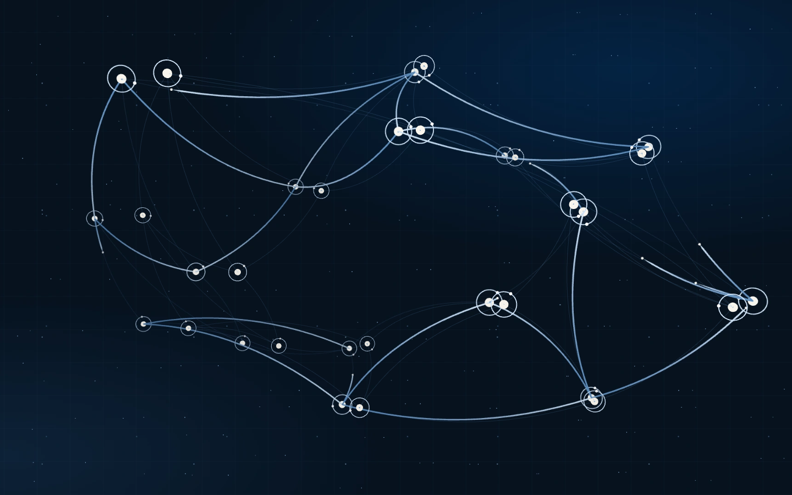
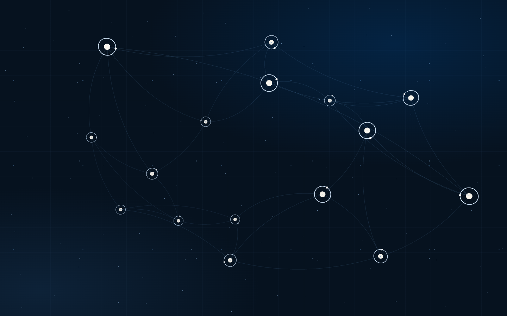

# Independent review of SPF Task 8 / PR #132

**Recommendation: request corrections.** Standards: one P2 finding. Spec: two P2 findings. All three remain **OPEN**. This record does not approve the posters, rotating bead, replacement baselines, hardware behavior, Task 8 completion or W6.

Reviewed [PR #132](https://github.com/Furlanich/Portfolio/pull/132), head `07d1c9279c0ca07f4b0913b6221deae68bc68d2f`, against merge-base `4c9ec07b7947b3fc3e6bfd2b53055298dc96a9a4` (47 changed files, 11 commits). Commands: `git diff 4c9ec07b...07d1c927`, `git log 4c9ec07b..07d1c927 --oneline`. Current remote main when reviewed was `c04f8ec11999bc4a8600b5925820ed3bf252414c`, which includes dependency PRs #130 and #131. The historical RED W5 is preserved; the subsequent accepted rerun authorizes Task 8.

This is a separate top-level OpenAI Codex session with no contribution to the implementation. Source was inspected and tested in an isolated app-managed checkout pinned to the reviewed head. Temporary diagnostic tests were removed; the review PR contains documentation and evidence only, based on current main. No implementation correction or baseline adoption was performed.

Agent usage: primary OpenAI Codex GPT-6 (exact provider model identifier/settings not exposed by the harness); subagents 0/0 (none). PASS. The implementer's receipt declares Claude Sonnet 5.5, subagents 0/0; no contrary evidence was found. The code-review skill's two review axes ran inline: degraded isolation under GOV-AGENT-USAGE I-10, without subagents. Applied repository Skills: systematic-debugging, playwright-qa, visual-qa, project-knowledge-maintenance, verification-before-completion and pr-readiness.

## Standards

### SPF-T8-03 / P2 — Keep the bead's pending approval separate from the approved node direction

Target: [design amendment, line 216](https://github.com/Furlanich/Portfolio/blob/07d1c9279c0ca07f4b0913b6221deae68bc68d2f/docs/design/services-projects-footer-v1.md#L216). [GOV-KNOWLEDGE](../../governance/knowledge-management.md#classification-rule) requires item-level APPROVED/PROPOSED/OPEN status to reflect evidence, and says existing code does not imply approval.

The bead is included in **Approved bounded supersessions**, under **Owner direction**, but the [implementation receipt](https://github.com/Furlanich/Portfolio/blob/07d1c9279c0ca07f4b0913b6221deae68bc68d2f/docs/reviews/services-projects-footer-acceptance-v1/task-8.md) Ruling 7 describes it as "my choice" and says it is the first thing to inspect. The PR body requests the owner's decision on whether it is appropriate. The record therefore implies approval that its supporting receipt explicitly leaves pending.

Suggested change: retain the approved flat-dot/one-ring direction, label the bead treatment **PROPOSED / owner approval OPEN**, and record the eventual decision once it exists. Do not present removing the bead or accepting still nodes as an already-approved alternative. This is a documentation-authority finding, not a demand to remove an implementation candidate.

No additional documented-standard violation or actionable baseline code smell was identified. The receipt's late Skill reads, omitted preflight and post-implementation browser tests remain disclosed workflow deviations; this review does not retroactively turn those into compliant TDD or owner approval.

## Spec

### SPF-T8-01 / P2 — Replace the poster when the transparent live canvas takes over

Changed target: [media publication, line 36](https://github.com/Furlanich/Portfolio/blob/07d1c9279c0ca07f4b0913b6221deae68bc68d2f/lib/connected-studio/media-manifest.ts#L36), integrated with `ConnectedStudioEnhancement`, `connected-studio.module.css` and `create-connected-scene`. DESIGN-SPF-V1 requires a matched static alternative, a fade to the optional canvas, and the specified 16/8-node field with reversible connection growth.

Publishing the posters exposes a composition defect: the renderer has `alpha: true`, while `[data-connected-poster]` remains visible at opacity 1 throughout live mode. No host or CSS state replaces it. A controlled live Services run at 1440x900, settled at page-top progress approximately 0 and then paused, still shows the poster's progress-0.60 nodes and bright connections underneath the current canvas. The visual field has a frozen second network, and connections remain visible after live growth reverses to zero.

Reproduction: enable the existing controlled software-renderer/live-policy hook; open `/servicios/`; wait for the initial settle; pause; hide foreground and decorative labels without reflow. Capture once, then set only `[data-connected-poster]` to `display:none` and capture again. The canvas pose and render count stay frozen; the extra nodes and bright connections disappear. Diagnostics: live/paused, zero pending callbacks, poster `display:block`, `visibility:visible`, `opacity:1`, seven live draw calls. The browser diagnostic passed its assertion that hiding the poster changes visible pixels; that is a successful reproduction of a defect, not an acceptance pass.

Suggested change: give the host explicit poster/canvas handoff state after the first successful render, remove the poster from the visible composition after the fade, and restore it on preference/capability/module/context-loss fallback. Keep the CSS chart beneath both. Add a failing browser regression for one graph after activation, reversal to zero growth, and restoration on fallback. Test-only hooks prove functionality; shipped live policy must remain false pending hardware evidence.

### SPF-T8-02 / P2 — Match projection and crop, not only pose values

Changed target: [start-pose integration, line 400](https://github.com/Furlanich/Portfolio/blob/07d1c9279c0ca07f4b0913b6221deae68bc68d2f/components/connected-studio/ConnectedStudioEnhancement.tsx#L400) and [capture viewports, lines 42–44](https://github.com/Furlanich/Portfolio/blob/07d1c9279c0ca07f4b0913b6221deae68bc68d2f/scripts/capture-connected-studio-posters.mjs#L42). Task 8 requires node/path continuity at the static-to-live transition; the dated design amendment says its first frame should avoid a jump.

`CONNECTED_POSTER_POSE` matches progress and idle angle, but the poster is captured at 1920x1080 wide or 450x800 compact and then painted with `background-size:cover; background-position:70% 30%`. Live geometry independently recomputes `spreadX`, tier depth/travel and node sizing for the actual viewport. The poster's node centres and live centres therefore disagree before any easing begins. Tablet also uses the wide poster, while the live tablet tier has different depth/travel.

A deterministic projection probe used the reviewed model, `computeConnectedLayout`, camera constants, zero elapsed time, progress 0.60 and idle angle 0.50. It projected corresponding nodes, then applied the actual CSS cover scale and offset to the captured coordinates:

| Actual viewport / tier | Maximum centre mismatch | Mean mismatch | Poster node centres outside viewport |
| --- | ---: | ---: | ---: |
| 1920x1080 / wide (capture control) | 0px | 0px | 0 |
| 1440x900 / wide | 83.58px | 38.85px | 0 |
| 768x1024 / tablet | 530.09px | 251.00px | 6 of 16 |
| 390x844 / compact | 47.44px | 22.19px | 0 |
| 320x800 / compact | 72.77px | 34.04px | 1 of 8 |

Method: `s=max(viewportWidth/captureWidth, viewportHeight/captureHeight)`; poster coordinates are `captureCentre*s + ((viewportWidth-captureWidth*s)*0.70, (viewportHeight-captureHeight*s)*0.30)`. Project live centres using the actual tier/layout, then take Euclidean distances. The zero-distance capture control checks the comparison. These are node-centre geometry results, not screenshot pixel error, hardware measurements or CLS. The existing first-frame tests inspect pose scalars and cannot detect this mismatch.

Suggested change: define a shared first-frame projection/crop contract for the poster and live scene across aspect ratios, including the tablet tier; alternatively obtain explicit owner acceptance of a transition that does not promise spatial continuity. Do not merely increase pose tolerances. Add a failing first-frame alignment test at 1440x900, 390x844 and portrait tablet, then verify after fixing SPF-T8-01 so the frozen poster cannot conceal the result.

Both Spec defects affect the controlled live candidate and future enablement. Current shipped `{ wide:false, compact:false }` visitors remain on the static artwork; no claim of an active production live regression is made.

## Verification and acceptance boundaries

Fresh reviewer checks on the pinned implementation head:

| Command / scope | Result |
| --- | --- |
| Locked npm ci | PASS; initial sandbox EPERM was followed by the identical install outside the sandbox |
| npm test | PASS, 492/492; standalone run and validate run |
| npm run validate | PASS, exit 0: 311 Markdown files / 107 IDs / 38 Skills; 492 tests; lint 0 errors / 282 existing warnings; typecheck; root production build |
| npm run verify:static-export, root | PASS, 14 routes |
| NEXT_PUBLIC_BASE_PATH=/Portfolio npm run build, then npm run verify:static-export | PASS, exit 0, 14 routes at /Portfolio |
| npx playwright test tests/e2e/connected-studio-static.spec.ts --project=chromium-desktop --workers=1 | PASS, 52/52, root, PLAYWRIGHT_PORT=3318; both locales, six selection widths, reduced motion, no JavaScript, image 404, image allocation and candidate selection |
| npx playwright test tests/e2e/connected-studio-runtime.spec.ts --project=immersive-chromium --workers=1 --grep 'live scene starts on the poster pose' | PASS, 2/2, root, port 3319; controlled SwiftShader and fake clock; scalar pose behavior only |
| Temporary reviewer browser diagnostic for SPF-T8-01 | Reproduced, 1/1 diagnostic assertions passed, port 3318; evidence images above; temporary spec removed |
| Zero-time node-centre projection probe for SPF-T8-02 | Reproduced at the five viewports in the table; capture-size control has zero mismatch |
| git diff --check 4c9ec07b..07d1c927 | PASS |

The initial diagnostic launch preceded completion of npm ci and failed because the Playwright executable was not yet installed; the unchanged rerun after installation passed. One initial standalone Node-log redirect failed because its ignored directory did not exist and ran no tests; the directory was created and both subsequent complete Node runs passed. Generated next-env.d.ts changes from build/dev commands were inspected and restored before review publication.

Not rerun by this reviewer: the complete multi-engine e2e matrix, axe project, full visual-baseline suite, /Portfolio browser matrix, Home measurements, physical-device/GPU/screen-reader/real-zoom checks or motion recording. The implementer's receipts remain their historical evidence; they are not fresh reviewer passes. Visual judgment in this review is limited to the paired 1440x900 diagnostic captures. Software rendering is functional evidence only.

Notices, separate from errors: existing lint warnings, Node module-type and color-environment notices, stale Browserslist data. npm ci reported existing dependency advisories; dependency changes are outside this review.

The complete diff was read for application scope, tests, art, documentation, accidental disclosure and unrelated edits. The original conceptual WebPs, protected brand source, copy/evidence, routes, Home source, dependencies and shipped live policy are unchanged. The raw `` approach fits static export: the installed Next.js guide explicitly excludes `srcSet` from forwarded Image props. Four posters are 87,164 bytes wide and 50,434 bytes compact, within their ceilings; six derivatives and their base-path candidate list are covered by the contracts. Ratio allocation and localized captions remain intact.

Remote PR CI observed at head `07d1c927`: [run 38309426233](https://github.com/Furlanich/Portfolio/actions/runs/38309426233), validate PASS, browser FAILURE after 45m4s. The incomplete log includes a WebKit navigation failure and failure plus retry of the first-scroll-notch case; there is no complete suite summary. The implementer discloses that notch failure on its unchanged W5 control. This review has not established its root cause and does not attribute it to Task 8. Passing local diagnostics cannot substitute for a complete green PR run.

**OPEN before Task 8 acceptance:** corrections and separate-session re-review of these findings; complete PR CI; owner review of the four posters, eleven Windows baseline changes, bead/start-pose motion and corresponding static/preference states; governed Linux baseline adoption and verification; the post-merge W6 checkpoint. OD-4 hardware/device/screen-reader/real-zoom evidence remains with its existing owner. No baseline approval, hardware PASS, Task 9 dispatch or human merge is inferred.

**Review-record PR readiness:** documentation and evidence scope only; source findings and all approval statuses preserved; primary/subagent audit PASS; publication validation and full diff review recorded below. Implementation readiness remains request corrections. A human retains merge authority for both PRs.

Publication validation: the first docs check scanned the ignored temporary Markdown draft, reporting its duplicate ID and relative link. The draft was deleted; the owning review file and indexes remain the only Markdown changes. Final publication validation: npm run validate PASS, exit 0 (311 Markdown files / 108 IDs / 38 Skills; 472/472 Node tests; lint 0 errors / 282 existing warnings; typecheck and root production build). Final npm run docs:check and git diff --check PASS. Full publication diff review PASS: three Markdown files and two intentional reproduction screenshots only; no application, test, dependency, baseline or generated-file edits. Documentation IDs/links and existing approvals/OPEN gates remain coherent. Agent-usage audit PASS, subagents 0/0. New PR CI and human review/merge remain OPEN.
