# Design discovery evidence

Exploratory captures; not approved design or production acceptance.

## Initial three directions

These precede the selected A.1 width, inertia and quieter Contact refinement.

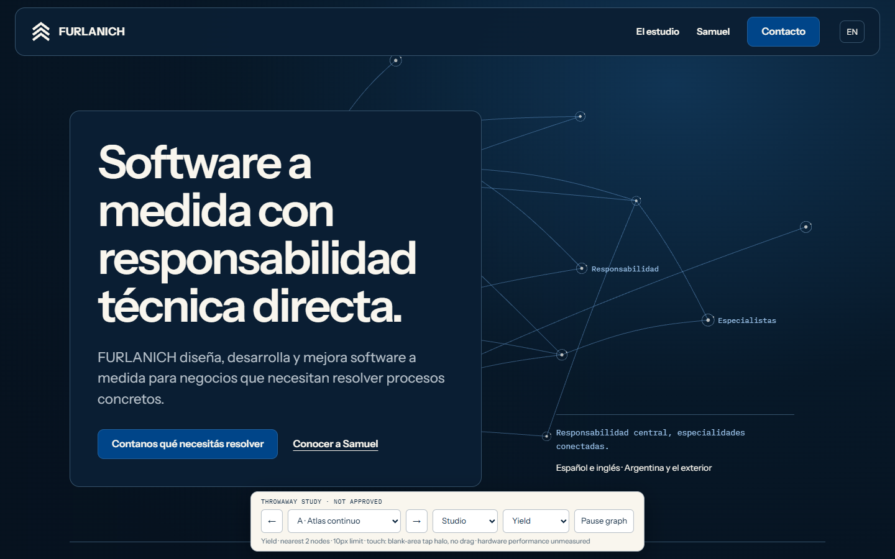

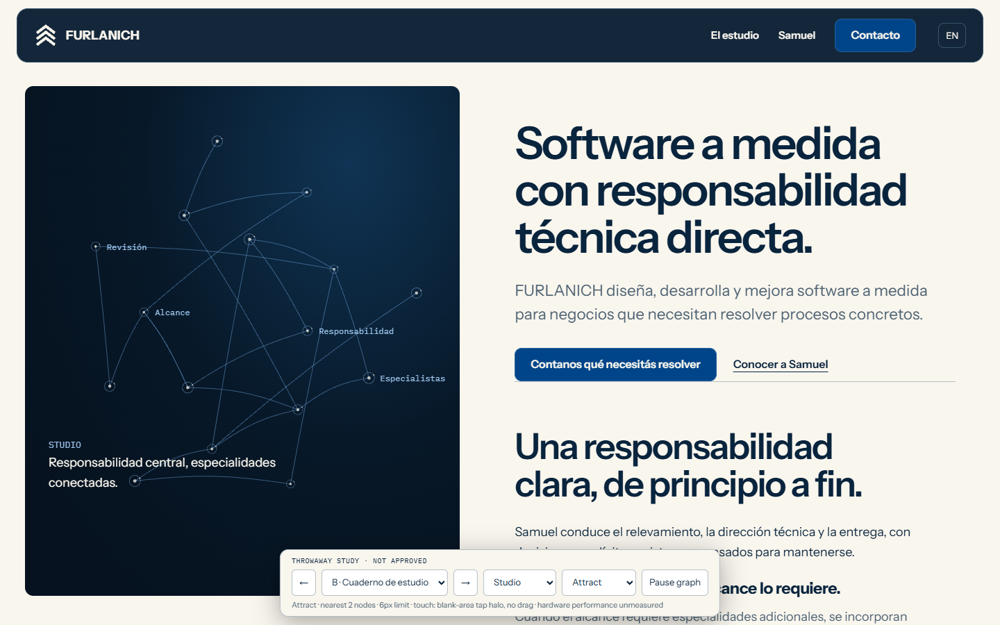

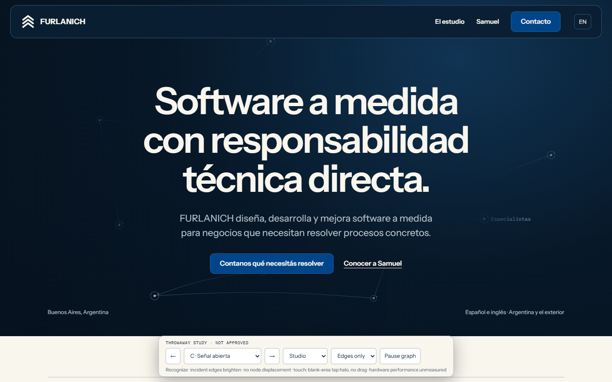

## Studio compact

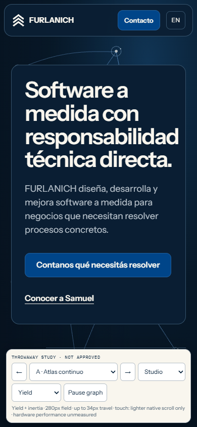

## Founder wide

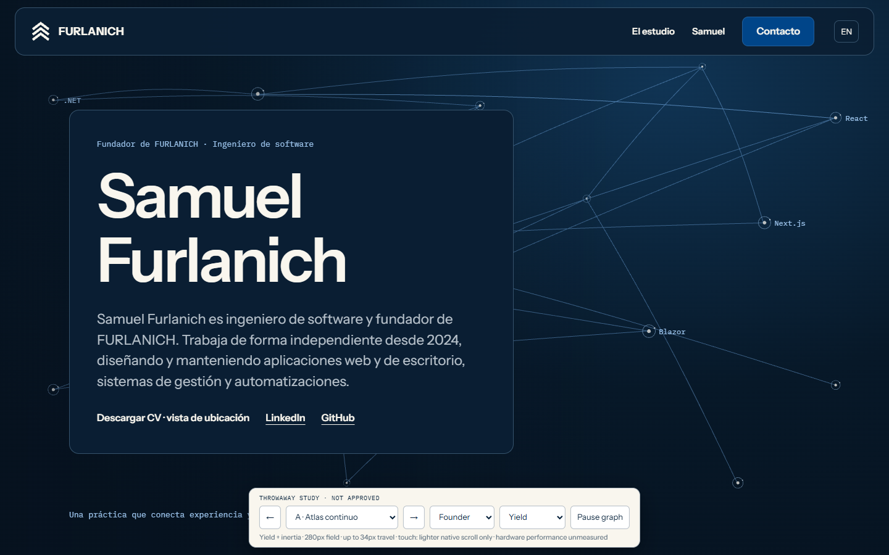

## Founder compact

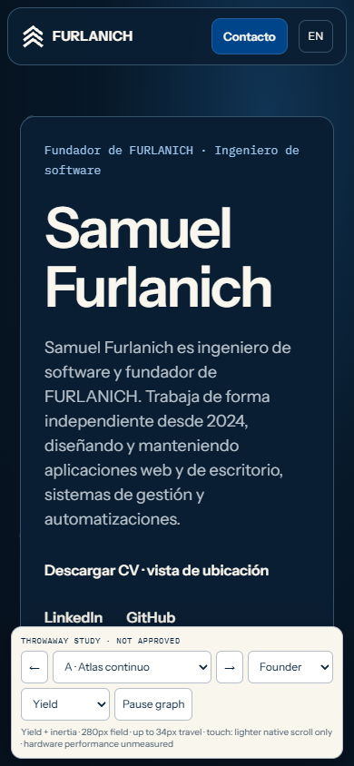

## Contact compact

## Cursor and inertia

<video controls src="a1-cursor-inertia.webm"></video>

The local file a1-cursor-inertia.webm is a software-rendered Playwright recording with an added pointer indicator. It demonstrates continued movement and settling after input stops; it does not establish hardware frame performance.

## A.2 flexible strings

The owner retained A.1 node motion and asked for strings. These captures show the revised page compositions; the recording demonstrates attached endpoints, local bending and a settling tail. An automated pointer indicator is included. No hardware timing or production-engine acceptance is implied.

<video controls src="a2-flexible-strings.webm"></video>

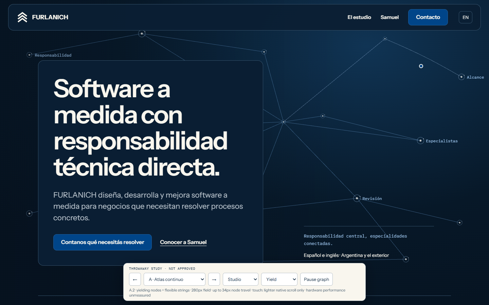

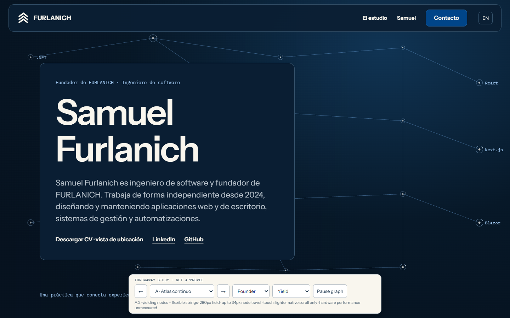

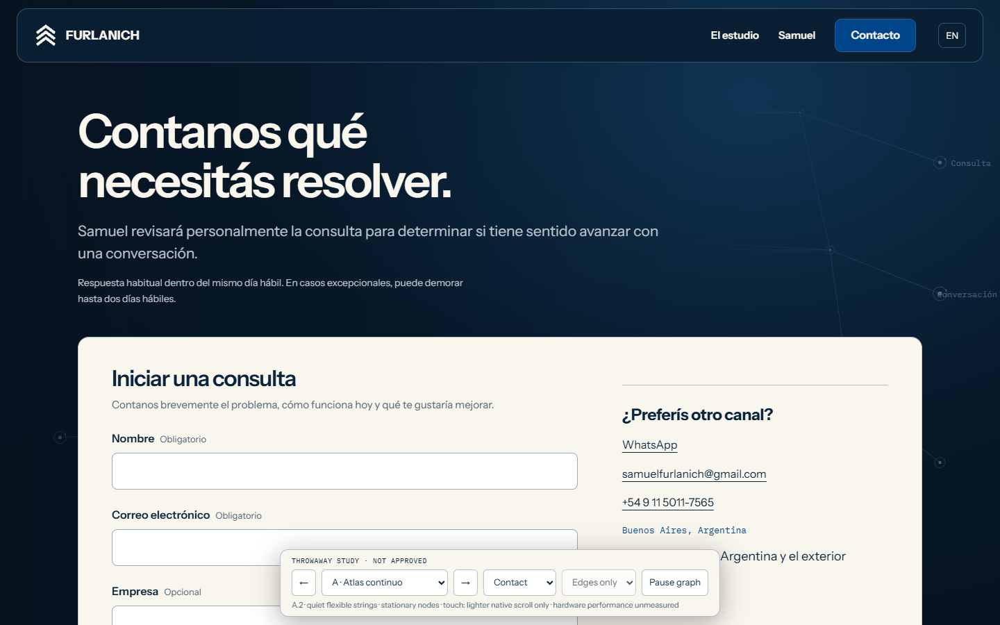

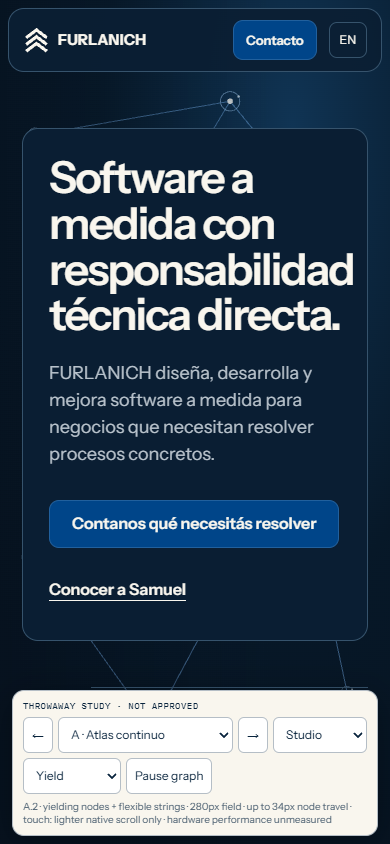

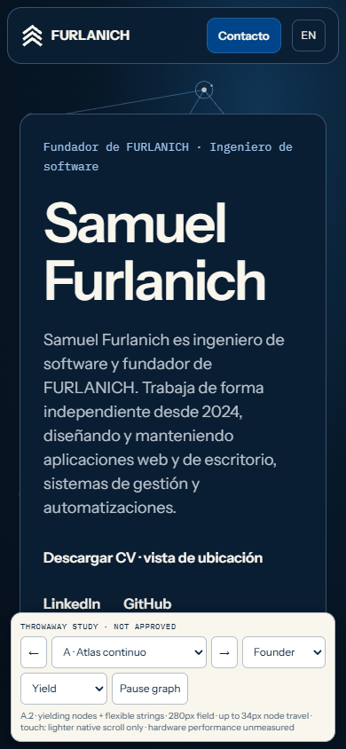

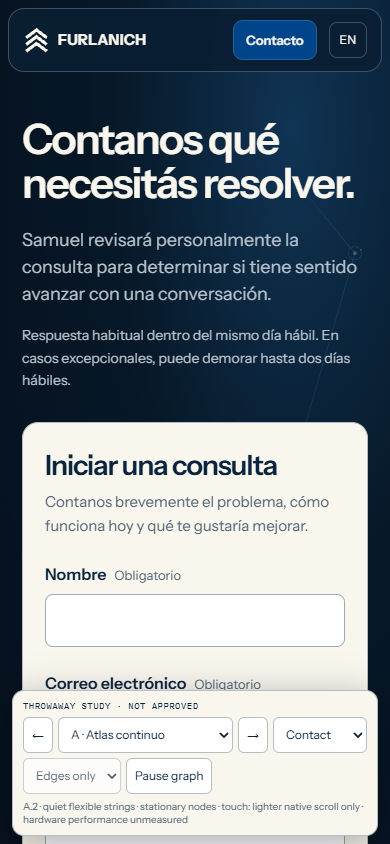
