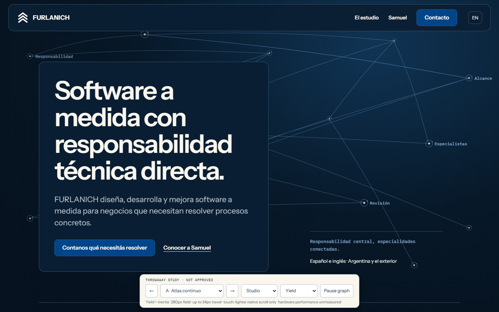
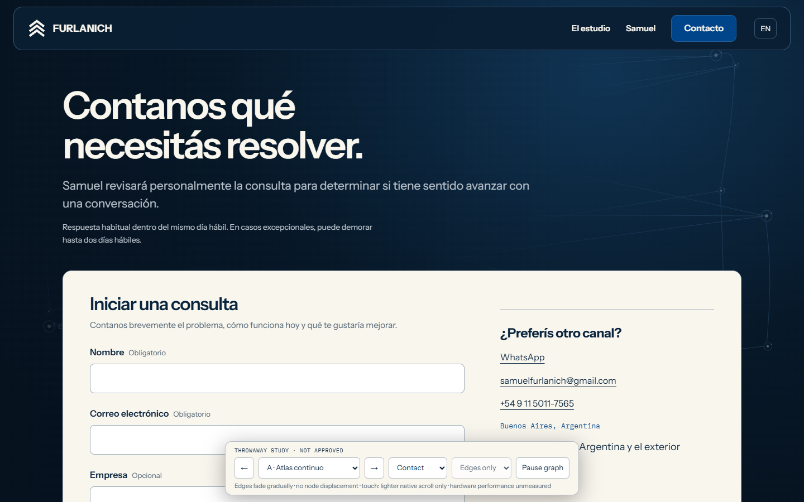

# Studio, Founder, Contact and legal — design discovery

This is an in-progress design review, not an approved final specification or an ADE v2 implementation plan. The owner selected Direction A for refinement. Final visual/motion approval, written design approval, commercial processor facts and professional legal review remain OPEN. No product code, deployment configuration, live policy or immutable ADR is changed.

Agent usage: one primary Codex session; subagents 0/0. Grilling research and Impeccable assessment run inline under GOV-AGENT-USAGE. This is not an independent review.

## Audit base and important findings

The initial audit pinned local and remote main at bd5cd66aa0282735245605f1063ad5912a60d3ed (PR #140). It inspected the repository authority, current localized UI, graph host/controller/engine, inquiry port/adapter and demo mode, test harness, prior ADE task packets and provider rules, installed skills and available plugins.

Current Services/Projects are static because both connected live tiers remain disabled. The frame-pacing receipt records a fixed scheduler defect and a remaining scene-related presentation tail; two of four desktop runs still missed the 20ms active p95 gate. Existing evidence measured the optional engine closure at 114.4KiB Brotli against 120KiB. Those are historical production facts, not new measurements of this prototype.

The current graph already has pure state/model/controller seams and a separate browser host and Three.js engine. Candidate architecture is to extend those seams, refactor a measured bottleneck only as needed, and preserve Home's separate runtime contract. No decision to enable a tier or combine runtimes is implied.

The dormant Formspree adapter exists, but Contact only accepts demonstration mode. Existing tests require local simulation, exact demo disclosure and zero transmission. Activation needs a new accepted supersession and corresponding test migration; deleting those guarantees alone is not a migration. The adapter's always-empty honeypot value also needs a real behavioral bot-trap decision.

Privacy already has its localized pair. Replace its disclosure; do not introduce duplicate Privacy URLs. Terms adds a pair within the existing routing architecture.

## Owner decisions — APPROVED for this initiative

| Decision | Owner answer, 2026-10-14 | Boundary |
| --- | --- | --- |
| Host | Keep GitHub Pages and /Portfolio | No hosting/custom-domain migration |
| Terms scope | Website use and initial inquiries only | Individual service contracts retain scope, pricing, payment, IP, warranty and support terms |
| Founder portrait | Keep the profile text-led; portrait deferred | No generated person, silhouette or empty image column |
| Direction to develop | A, with quieter Contact | Refinement choice, not final approval |
| Graph response | Keep A.1 node motion; edges must behave like strings | A.2 explores pinned, flexible interiors with a settling wave; exact string values and final direction still proposed |
| Touch | Lighter native-scroll response only | Remove the provisional tap response; preserve native gestures and form input |
| Responsible party and supplied address | Confirmed by owner | Owned by [Contact/Privacy](../../product/pages/contact-and-privacy.md#owner-facts-for-the-proposed-commercial-activation-approved-2026-10-14); legal sufficiency remains OPEN |
| Existing form and notification/privacy email | Existing Formspree endpoint and existing Gmail confirmed | Same owner section; account settings, delivery and deletion still unverified |
| Provider tier and abuse posture | Owner confirmed basic Free; accepted filtering plus a real honeypot, with a challenge only when justified | Explicit owner configuration/receipt checklist now belongs to Contact/Privacy |
| Page hierarchies | Retain the presented sequences and quiet legal reading surface | Target order approved; full visual/spec approval still OPEN |

## Three directions explored

| Direction | Structural difference | Disposition |
| --- | --- | --- |
| A — Continuous atlas | Opaque editorial plates over a continuous dark chart field; distinct Studio argument, Founder dossier and intake composition | Selected for refinement |
| B — Studio notebook | A dedicated fixed graph pane beside a Bone reading column; pane becomes a top composition on phones | Not selected; graphic-first mobile Contact delays intake |
| C — Open signal | Unboxed typographic opening, full-width light reading chapters and dark pauses | Not selected as the overall structure; quieter Contact treatment adapted |

The interactive comparison contained Studio/Founder/Contact in both languages, a legal reading shell, separate layout/response controls and local-only form-state previews. Its initial bounded check covered 18 Spanish views across 1440x900 and 390x844 with no document overflow or page-script errors. English Contact error preservation/success and reduced-motion no-engine loading were also checked. These are exploratory checks, not production acceptance.

The [initial comparison captures](assets/gallery.md#initial-three-directions) preserve the structural alternatives before the selected A.1 refinement.

## A.1 — current motion candidate

The owner requested a wider, more responsive graph whose movement fades through inertia after cursor input stops. A.1 keeps the comparison's 16 wide / eight compact nodes and spreads the wide anchors across approximately 88% of viewport width. Node count/topology in the production engine is not changed by this probe.

| Candidate property | A.1 probe value / behavior |
| --- | --- |
| Wide interaction field | 280 CSS px radius, strongest near the pointer, up to five nearby nodes with a small response shared with connected neighbors |
| Wide travel | Up to 34 CSS px; fixed camera; perspective depth, flat camera-facing dots/rings |
| Physics | Time-based damped spring, stiffness 42 / damping 10 at unit mass; bounded velocity impulse from cursor travel |
| After input stops | Pressure and velocity decay; movement continues and settles, rather than holding a rigid displaced pose or stopping abruptly |
| Edges | Endpoints remain attached; a bounded curvature lag follows node movement and fades; incident emphasis decays |
| Compact | Eight nodes, up to 14px local travel from ordinary scrolling; no tap or drag interaction |
| Contact | Stationary nodes, restrained fading edge emphasis; reduced visual density around the introduction; opaque Bone intake surface |
| Preferences/control | Reduced motion and Pause show a static composition; no Three.js request for reduced-motion initial load |
| Reading | Immediate foreground content; no moved buttons, pointer camera, scroll interception, text reveal or essential canvas information |

These are **PROPOSED probe inputs**, not a frozen implementation specification or permission to exceed existing performance gates. The comparison now uses direct Three.js perspective geometry but still does not reproduce the production engine's full graph topology, scroll choreography, posterior continuity, label handling, capability gates or resource lifecycle. Production code must be written test-first from the approved specification, not copied from this experiment.

## A.2 — flexible strings, pending owner feel-check

The owner retained A.1's node motion and requested flexible strings rather than rigid edges. A.2 leaves the node model, width and amplitude intact. Each edge has pinned ends attached to the current node positions and five interior transverse samples with independent velocity. Local pointer proximity and endpoint movement excite the interior; tension shares movement with neighboring samples, damping dissipates it, and the renderer interpolates the samples into a continuous curve. There is no idle wobble, gravity sag, background tap, dragged edge or hit target.

Candidate interior spring values are tension 90, restoring stiffness 32 and damping 7, with the existing 120Hz maximum integration step. Interior travel is bounded at 16 CSS px wide / 6px compact / 4px on Contact. Contact nodes stay fixed; its strings bend and emphasize quietly. These numbers describe the experiment; acceptance requires the approved production model and rendering/performance receipts. No rope/physics package is proposed.

The page-specific compositions also become explicit in this revision:

| Surface | Proposed composition and meaning | Boundary |
| --- | --- | --- |
| Studio | Central accountability junction connected to dispersed specialty branches | Does not imply an employee roster or named partners |
| Founder | A right-side vertical spine with branching experience, education, capability and evidence stations | Abstract professional depth; no invented timeline, qualification, score or technology-logo wall |
| Contact | Sparse connections converge along the outer right side; lower opacity and protected reading/intake area | No form-following pointer, moved control or essential graph information |
| Services / Projects | Keep each approved composition and chapter meaning, adding the shared proximity/string response if feasibility passes | No content/layout redesign or Home-runtime merger inferred |
| Privacy / Terms | Static legal reading surface without a graph runtime | Main commercial experience remains visually primary |

Compact studies use eight nodes and a simpler connected composition; the scroll response and string amplitude are smaller. All information remains in ordinary HTML. Composition meaning is a design aid, not an interactive explanation the visitor must discover.

The [A.2 gallery and focused recording](assets/gallery.md#a2-flexible-strings) preserve the revised studies. This remains a throwaway rendering experiment; it does not reproduce production topology, pooled buffers, lifecycle or capability decisions.

The prototype header is study navigation, not a proposed navigation change. Production retains the approved shared App Bar and Footer, Founder outside primary navigation, existing protected-mark geometry and locale behavior. Only the required legal Footer destinations are added through the eventual approved specification. The comparison toolbar, abbreviated copy and CV placement label are not product UI.

## Confirmed target page hierarchy

The owner confirmed this target reading order. [Studio/Founder](../../product/pages/studio-and-founder.md#redesign-target-hierarchy-approved-2026-10-14-final-design-open) and [Contact/Privacy](../../product/pages/contact-and-privacy.md#completed-contact-hierarchy-approved) retain the normative responsibilities and existing factual copy/evidence boundaries.

| Page | Confirmed target reading sequence |
| --- | --- |
| Studio | Identity and operating model → Samuel's direct accountability and collaborator boundary → principles → location/availability → concise Founder bridge → commercial Contact action |
| Founder | Name, role and complete approved biography → CV/LinkedIn/GitHub → experience → education → grouped capabilities → selected evidence/source bridges → commercial Contact action |
| Contact | Introduction and response expectation → four-field form/privacy context → direct alternatives/location → subdued Founder bridge |
| Privacy / Terms | Title and applicability/update information → concise contents navigation → readable sections → contact/reference links; shared quiet legal composition |

Contact uses a wide Bone form-led intake area and stacks in the approved source order on phones. Its response expectation stays before the form in source order. The legal address belongs in legal disclosure; it does not silently replace the broader commercial availability wording.

Exact composition, responsive values, page-specific graph meaning/labels, complete bilingual content and final approval remain to be closed before the implementation plan. The prototype uses abbreviated editorial copy for comparison; it is not authority to drop the full biography, the internship, capability groups, MPC qualifications or evidence limits. The written design must show the complete retained copy and exact deltas before approval.

## Rendered evidence

Compact studies and Founder wide are in the [capture gallery](assets/gallery.md). The [cursor/inertia recording](assets/gallery.md#cursor-and-inertia) includes an automated pointer indicator; it is a software-rendered design probe.

The selected refinement was checked at 1440x900 and 390x844 for all three pages in ES/EN: 12 rendered views, one H1/canvas each, no document overflow or page-script errors. The rendered pointer check observed continued movement 240ms after input stopped, bounded 34px travel and eventual rest. The compact check observed no movement from tapping and bounded response from native scrolling. Contact nodes remained stationary while edges responded. Reduced-motion initial load requested no engine and created no canvas.

Five focused tests exercise the throwaway momentum model: missing model RED observed before it was written; GREEN checks continued movement/rest, travel bounds/finite values, quiet Contact, and continued motion on pointer exit. These do not replace production TDD or its RED/GREEN receipts.

No hardware timing, production bundle, Firefox/WebKit, axe, real touch device, screen reader, static-export/base-path or commercial delivery/deletion acceptance is claimed by this evidence.

A.2 repeated the 12-view ES/EN wide/compact checks successfully. Eight probe tests now pass; the three added string checks first failed because interior samples were absent, then passed with the string model. They cover pinned ends/local deformation, post-input momentum/bounds/rest and Contact's fixed nodes with a quieter bend. The focused rendered string receipt is supplementary to the full-page captures.

The unchanged repository suite passed **519/519** on 2026-10-14. An initial sandboxed run passed 513 and failed six local-server checks with loopback `EACCES`; rerunning with local-server access passed all six and the full suite. This is baseline coverage, not evidence that the proposed commercial or production 3D changes exist. Documentation validation is rerun after each material record update; full `npm run validate` has not been claimed for this design discovery.

## Major skill recommendations and conflict resolutions

| Skill | Recommendation | Disposition |
| --- | --- | --- |
| Brainstorming | Architectural discovery, alternatives, design/spec approval before plan | Accepted; no plan yet |
| Grill-me / Grilling | Prerequisite-aware rounds, factual research by the agent | Adapted inline; repository policy overrides research delegation |
| Taste v1 | Deliberate hierarchy, narrow continuous-interaction boundary, complete states and pre/postflight | Adapted; keep approved palette/fonts/stack and reject magnetic controls, perpetual UI loops and generic reveals |
| Taste v2 | Audit incumbent identity and make structural alternatives | Advisory only; does not replace the repository v1 execution contract |
| Impeccable shape/craft | Separate persuasion, operation and reading; legible hierarchy, responsive/contrast review | Adapted to existing documentation owners; no competing PRODUCT.md/DESIGN.md authority; inline assessment |
| Emil Design Engineering | Interruptible spring response with purpose, quiet touch behavior | Adapted to owner-requested stronger inertia; no cartoon bounce or moving targets; repository static reduced-motion rule prevails |
| Animate | Purpose, interruption, cheap tools and preference handling before timing | Design advice only; construction workflow not executed on product code |
| Brag | Clear opening, meaningful middle and deliberate conclusion | Storyboard advice adapted; video-production workflow, Hyperframes and soundtrack rejected for this website task |
| Prototype UI | Three structurally distinct, inspectable directions with visible state | Adapted to an isolated artifact, not product routes |
| TDD / Playwright QA / Visual QA | Distinct stable behavior tests, browser checks and rendered judgment | Accepted; exploratory results explicitly separated from production acceptance |

Figma is connected and reports a Starter/View seat; no design-file write was attempted. Interactive HTML served the motion comparison. No dedicated Three.js skill or relevant Formspree connector was found in the inspected sources/plugin search, so no speculative plugin was installed.

## Open decision frontier and next gate

- Owner feel-check of A.2's strings and page-specific compositions; A.1 node motion is retained.
- Final written design approval, including complete bilingual copy, responsive specification, legal route names, reduced-motion/fallback and measured production feasibility boundaries.
- Formspree Free account settings and operations: validation, domain restriction, CAPTCHA, quota, storage, retention, notification, material subprocessors and processing/transfer facts. The exact owner actions are in the [readiness checklist](../../product/pages/contact-and-privacy.md#formspree-free-readiness-checklist-proposed-operational-requirements); no account setting or paid upgrade has been performed.
- Original ES/EN Privacy and Terms draft with professional Argentine review markers; address sufficiency, consent/transfer mechanism and any required disclosures remain OPEN.
- The first original bilingual drafts now live in their [Privacy](../../product/pages/contact-and-privacy.md#original-commercial-privacy-draft-proposed-professional-review-required) and [Terms](../../product/pages/terms-and-conditions.md#original-spanish-draft-proposed-professional-review-required) owners. They are explicitly unapproved and non-publishable; provider/retention/transfer and legal-review gaps remain visible.
- Hardware feasibility within retained budgets, including the unresolved connected presentation tail; no tier enablement inferred.
- New governance RFC and, after acceptance, superseding ADR for the demonstration/public-intake and new route-runtime boundaries.
- Then and only then: ADE v2 plan using the user-requested GPT-6 Luna High / Claude Sonnet 5 High implementation providers, exact identifiers verified before execution, and independent Claude Opus 5.5 High review-only in a separate session.

Task-level concurrency must follow current GOV-AGENT-USAGE: independent top-level task sessions/worktrees with disjoint write sets and resources. Literal implementation subagents cannot silently override that policy. No provider-version substitution or delegation has occurred in this discovery.
